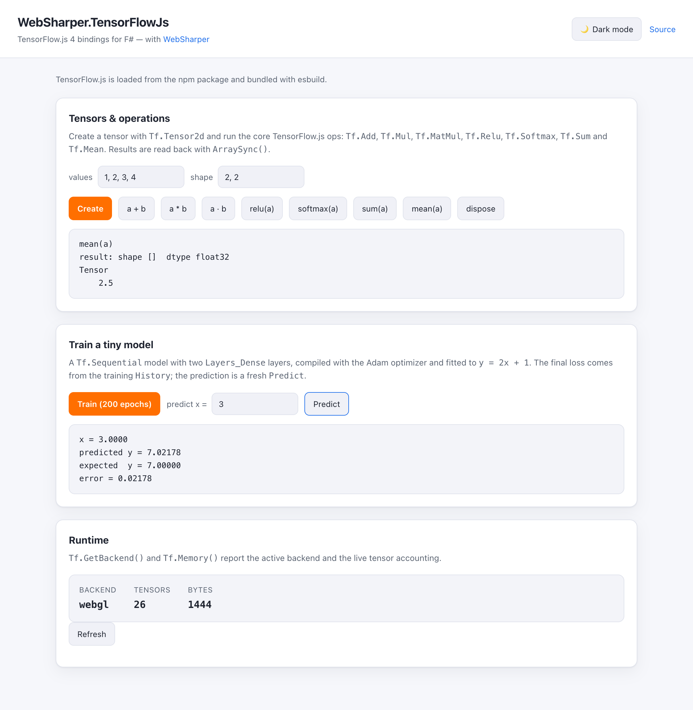

# WebSharper.TensorFlowJs

[](https://www.nuget.org/packages/WebSharper.TensorFlowJs)

An F# [WebSharper](https://websharper.com/) binding for
[TensorFlow.js](https://www.tensorflow.org/js), enabling machine learning and
tensor computation in browser-based WebSharper applications.

The binding targets **TensorFlow.js 4.x** (`@tensorflow/tfjs` 4.22.0+) and is
imported from the npm package, so it bundles cleanly with esbuild/webpack — no
CDN `<script>` required.

## Repository structure

| Project | Kind | Description |
|---|---|---|
| `WebSharper.TensorFlowJs` | binding | The WIG definition (`Main.fs`, `MainClasses.fs`, `Interfaces.fs`, `Types.fs`, `Enumeration.fs`) building the `Tf` API surface. |
| `WebSharper.TensorFlowJs.Sample` | sample | A static esbuild SPA that exercises the binding (tensor ops, a trained model, runtime stats). |

## Live demos

**Try it live:** [Open the sample in your browser](https://dotnet-websharper.github.io/TensorFlowJs/)



The sample doubles as the binding's [test case](#running-the-test-case): it
creates tensors and runs the core ops, trains a `Sequential` model with
`Layers_Dense` on `y = 2x + 1`, predicts a value, and reports the active backend
and live tensor accounting from `Tf.Memory()`.

## Install

```
dotnet add package WebSharper.TensorFlowJs
```

or, from the Package Manager console:

```
nuget WebSharper.TensorFlowJs
```

## Usage

The whole `@tensorflow/tfjs` namespace is exposed as the `Tf` type. Nested
members use `_` instead of `.` in .NET, and the layer *factories* (which are
lowercase functions in JavaScript, e.g. `tf.layers.dense`) keep their
capitalized .NET name via `WithSourceName`:

| TensorFlow.js | .NET |
|---|---|
| `tf.tensor2d(...)` | `Tf.Tensor2d(...)` |
| `tf.add(a, b)` | `Tf.Add(a, b)` |
| `tf.layers.dense({...})` | `Tf.Layers_Dense(DenseLayerArgs(...))` |
| `tf.sequential()` | `Tf.Sequential()` |
| `tf.train.adam(...)` | `Tf.Train_Adam(...)` |

```fsharp
open WebSharper.TensorFlowJs

[<JavaScript>]
let TensorsAndOps () =
    let a = Tf.Tensor2d([| 1.0; 2.0; 3.0; 4.0 |], [| 2; 2 |])
    let b = Tf.Ones([| 2; 2 |])

    let sum  = Tf.Add(a, b)
    let prod = Tf.MatMul(a, b)
    let act  = Tf.Relu(a)

    // Tensor.ToString() renders any rank; dataSync() reads the flat values.
    JS.Console.Log(sum.ToString())
    JS.Console.Log((Tf.Mean(a)).ToString())
    JS.Console.Log(act.ToString())
```

### Building and training a model

`DenseLayerArgs`/`ModelCompileArgs`/`ModelFitArgs` are top-level records whose
**required** fields are positional constructor arguments and whose **optional**
fields are named:

```fsharp
open WebSharper
open WebSharper.JavaScript
open WebSharper.TensorFlowJs

[<JavaScript>]
let Train () =
    let n = 128
    let xs = Array.init n (fun i -> float i / float (n - 1) * 5.0)
    let ys = xs |> Array.map (fun x -> 2.0 * x + 1.0)
    let x = Tf.Tensor2d(xs, [| n; 1 |])
    let y = Tf.Tensor2d(ys, [| n; 1 |])

    let model = Tf.Sequential()
    model.Add(
        Tf.Layers_Dense(
            DenseLayerArgs(
                8,
                Activation = ActivationIdentifier.Relu,
                InputShape = Optional.ofOption (Some [| 1 |]))))
    model.Add(Tf.Layers_Dense(DenseLayerArgs(1)))
    model.Compile(ModelCompileArgs("adam", "meanSquaredError", "mse"))

    model.Fit(x, y, ModelFitArgs(16, 200, 0))
        .Then(fun history ->
            let losses: float[] = history.History?loss :?> float[]
            JS.Console.Log(sprintf "final loss = %f" losses.[losses.Length - 1]))
    |> ignore

    // `Predict` returns a `Tensor` (the JS union is converted implicitly).
    let pred: Tensor = model.Predict(Tf.Tensor2d([| 3.0 |], [| 1; 1 |]))
    JS.Console.Log(pred.ToString())
```

## Notes on the API

- **Namespace mapping.** `Tf` mirrors the `tf` namespace; dotted members become
  `_`-joined names (`tf.layers.dense` → `Tf.Layers_Dense`). The Principal types
  (`Tensor`, `TensorBuffer`, `Variable`, `Sequential`, `LayersModel`,
  `GraphModel`, `Dataset`, optimizers, initializers, constraints, regularizers)
  are top-level types in the `WebSharper.TensorFlowJs` namespace.
- **Tensor creation** uses `Tf.Tensor`/`Tf.Tensor1d`…`Tf.Tensor6d`, and accepts
  flat or nested `float`/typed arrays, `int`, `bool`, `string` — as TensorFlow.js
  does.
- **Operations** (`Tf.Add`, `Tf.Mul`, `Tf.MatMul`, `Tf.Relu`, `Tf.Softmax`,
  `Tf.Sum`, `Tf.Mean`, `Tf.Topk`, …) accept a `Tensor` or a flat `float[]`.
  This keeps the generated surface small: WebSharper emits one overload per
  union constituent, and the product across several union parameters grows
  exponentially (the upstream `basicLSTMCell`, with six `TensorLike` parameters,
  would otherwise generate a million overloads). Prefer wrapping inputs with
  `Tf.Tensor*` when in doubt.
- **Reading tensors.** `tensor.ToString()` renders any rank; `tensor.DataSync()`
  returns the flat values. `tensor.ArraySync()` returns JS arrays whose nesting
  follows the tensor's rank.
- **Models.** Build layers with the `Tf.Layers_*` factories, add them to a
  `Tf.Sequential()` or a functional `Tf.Model(ContainerArgs(...))`, then
  `Compile`/`Fit`/`Evaluate`/`Predict`. `Fit` returns a `Promise<History>`; the
  per-epoch metrics live on `history.History`.
- **Runtime.** `Tf.GetBackend()`, `Tf.Memory()`, `Tf.Tidy(...)`, `Tf.Dispose(...)`
  and `Tf.EnableProdMode()` are available for backend control and tensor
  lifetime management.

## Running the test case

The sample bundles `@tensorflow/tfjs` from npm with esbuild and emits a static
site in `dist/`:

```
cd WebSharper.TensorFlowJs.Sample
dotnet build -c Release
cd ..
dotnet serve -d dist -p 8080
```

Then open <http://localhost:8080/>, press **Create**, run the operations, press
**Train (200 epochs)** and **Predict**.

Requires Node.js/npm (for `@tensorflow/tfjs` + esbuild) and the
[`dotnet-serve`](https://github.com/dotnet-serve/dotnet-serve) tool
(`dotnet tool install -g dotnet-serve`).

## Build from source

The repository uses [Paket](https://fsprojects.github.io/Paket/) and the shared
WebSharper build script:

```
./build            # restore + build
./build WS-Package # build and pack the NuGet package
```

or, per project:

```
dotnet tool restore
dotnet paket restore
dotnet build WebSharper.TensorFlowJs.Sample/WebSharper.TensorFlowJs.Sample.fsproj -c Release
```

## Pack

```
WSPackageFolder=/tmp/pkg ./build WS-Package
```

produces `WebSharper.TensorFlowJs.<version>.nupkg` containing the binding
assembly, its `.websharper` metadata sidecar and XML docs.

## Deployment

`.github/workflows/ghpages.yml` builds the sample on .NET 11 and deploys `dist/`
to the `gh-pages` branch (only from the default branch), which serves
<https://dotnet-websharper.github.io/TensorFlowJs/>.

## License

The binding is licensed under the [Apache License 2.0](LICENSE.md)
(© IntelliFactory). It binds [TensorFlow.js](https://www.tensorflow.org/js),
which is also licensed under the **Apache License 2.0** (SPDX: `Apache-2.0`) —
see [`@tensorflow/tfjs` on npm](https://www.npmjs.com/package/@tensorflow/tfjs)
and the [TensorFlow license](https://github.com/tensorflow/tfjs/blob/master/LICENSE).
The npm package is bundled into the sample's `dist/` output; keep its license
notice when redistributing a built site.
